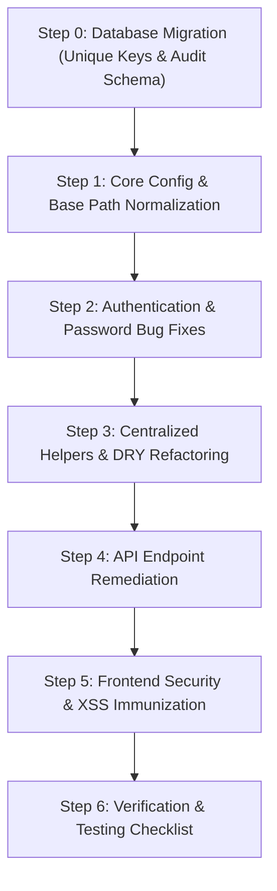

# CourseMonitor: Complete DIY Implementation & Remediation Guide

This guide is designed for you to edit and refactor the entire codebase yourself step-by-step. It provides exact file paths, line numbers, SQL migrations, before-and-after code diffs, and verification steps.

---

## Roadmap Overview



---

## Step 0: Database Schema Fixes & Migration

Run these queries against your MySQL database (`CourseMonitor`). This resolves duplicate grade insertions, crashes on audit logs, and inconsistent data relationships.

### 0.1 Deduplicate `coursework` & Add Unique Constraint
Currently, saving or importing grades creates duplicate rows because there is no unique key on `(student_id, course_id, assessment_type)`.

```sql
-- 1. Remove duplicate coursework rows, keeping only the latest entry per assessment
DELETE c1 FROM coursework c1
INNER JOIN coursework c2 
WHERE c1.id < c2.id 
  AND c1.student_id = c2.student_id 
  AND c1.course_id = c2.course_id 
  AND c1.assessment_type = c2.assessment_type;

-- 2. Add Unique Key to coursework so ON DUPLICATE KEY UPDATE functions properly
ALTER TABLE `coursework`
  ADD UNIQUE KEY `unique_student_course_assessment` (`student_id`, `course_id`, `assessment_type`);
```

### 0.2 Fix `audit_logs` Reason Column & Length
Currently, reasons longer than ~35 characters crash with a `Data too long for column 'action'` error.

```sql
-- Add a dedicated reason column and extend action length
ALTER TABLE `audit_logs` 
  MODIFY `action` varchar(50) NOT NULL,
  ADD COLUMN `reason` text DEFAULT NULL AFTER `action`;
```

### 0.3 Fix Existing Seed Password Hash Bug
Any users registered through `signup.php` or `save_user.php` have their password stored as string `'0'` due to an integer cast bug. Run this if you need to reset all test user passwords to a known default (`password`):

```sql
-- Reset test users password to bcrypt of 'password' ($2y$10$92IXUNpkjO0rOQ5byMi.Ye4oKoEa3Ro9llC/.og/at2.uheWG/igi)
UPDATE `users` 
SET `password` = '$2y$10$92IXUNpkjO0rOQ5byMi.Ye4oKoEa3Ro9llC/.og/at2.uheWG/igi' 
WHERE `password` = '0' OR `password` = 0;
```

---

## Step 1: Configuration & Base Path Normalization

### 1.1 `config/db.php`
**Goal**: Prevent database password exposure, support environment overrides, and log connection errors securely without leaking MySQL internals to visitors.

Replace `config/db.php` with:

```php
<?php
// config/db.php

$host     = getenv('DB_HOST') ?: 'localhost';
$db_name  = getenv('DB_NAME') ?: 'CourseMonitor';
$username = getenv('DB_USER') ?: 'root';
$password = getenv('DB_PASS') !== false ? getenv('DB_PASS') : '123';

mysqli_report(MYSQLI_REPORT_OFF);
$mysqli = new mysqli($host, $username, $password, $db_name);

if ($mysqli->connect_error) {
    error_log("Database connection failed: " . $mysqli->connect_error);
    header('HTTP/1.1 500 Internal Server Error');
    die(json_encode(['error' => 'Database connection unavailable. Please check system logs.']));
}

$mysqli->set_charset("utf8mb4");
```

---

## Step 2: Authentication & Core Functions

### 2.1 `includes/auth_functions.php`
**Goal**: 
1. Prevent duplicate `session_start()` warnings.
2. Provide a dynamic `base_url()` helper so URLs never break if the folder name or virtual host changes.
3. Make `requireRole()` return HTTP 401/403 JSON for API calls instead of redirecting with HTML.

Modify `includes/auth_functions.php`:

```php
<?php
if (session_status() === PHP_SESSION_NONE) {
    session_start();
}

require_once __DIR__ . '/../config/db.php';

/**
 * Returns dynamic base URL or resolves a relative path
 */
function base_url($path = '') {
    // Detect folder dynamically from current script path
    $scriptDir = str_replace('\\', '/', dirname($_SERVER['SCRIPT_NAME']));
    // Find where the project root is
    $parts = explode('/', trim($scriptDir, '/'));
    $rootIndex = array_search('CourseMonitor', $parts);
    if ($rootIndex !== false) {
        $base = '/' . implode('/', array_slice($parts, 0, $rootIndex + 1));
    } else {
        $base = '/' . ($parts[0] ?? '');
    }
    $base = rtrim($base, '/');
    return $base . '/' . ltrim($path, '/');
}

function login($username, $password) {
    global $mysqli;

    $stmt = $mysqli->prepare("SELECT id, username, password, role, full_name FROM users WHERE username = ? AND is_active = 1");
    if (!$stmt) {
        error_log("Login prepare failed: " . $mysqli->error);
        return false;
    }
    $stmt->bind_param("s", $username);
    $stmt->execute();
    $result = $stmt->get_result();

    if ($row = $result->fetch_assoc()) {
        if (password_verify($password, $row['password'])) {
            session_regenerate_id(true);

            $_SESSION['user_id'] = $row['id'];
            $_SESSION['username'] = $row['username'];
            $_SESSION['role'] = $row['role'];
            $_SESSION['full_name'] = $row['full_name'];
            $_SESSION['last_activity'] = time();

            return true;
        }
    }
    return false;
}

function isLoggedIn() {
    if (isset($_SESSION['user_id'])) {
        if (time() - ($_SESSION['last_activity'] ?? 0) > 1800) {
            logout();
            return false;
        }
        $_SESSION['last_activity'] = time();
        return true;
    }
    return false;
}

function logout() {
    $_SESSION = [];
    if (ini_get("session.use_cookies")) {
        $params = session_get_cookie_params();
        setcookie(session_name(), '', time() - 42000,
            $params["path"], $params["domain"],
            $params["secure"], $params["httponly"]
        );
    }
    session_destroy();
}

function requireRole($allowed_roles) {
    $isApi = (strpos($_SERVER['REQUEST_URI'] ?? '', '/api/') !== false) ||
             (isset($_SERVER['HTTP_ACCEPT']) && strpos($_SERVER['HTTP_ACCEPT'], 'application/json') !== false);

    if (!isLoggedIn()) {
        if ($isApi) {
            http_response_code(401);
            header('Content-Type: application/json');
            echo json_encode(['error' => 'Authentication required']);
            exit;
        }
        header("Location: " . base_url('public/login.php'));
        exit;
    }

    if (!in_array($_SESSION['role'], (array)$allowed_roles)) {
        if ($isApi) {
            http_response_code(403);
            header('Content-Type: application/json');
            echo json_encode(['error' => 'Permission denied']);
            exit;
        }
        header("Location: " . base_url('public/access_denied.php'));
        exit;
    }
}

function getCurrentUser() {
    return isset($_SESSION['user_id']) ? $_SESSION : null;
}

function generateCsrfToken() {
    if (empty($_SESSION['csrf_token'])) {
        $_SESSION['csrf_token'] = bin2hex(random_bytes(32));
    }
    return $_SESSION['csrf_token'];
}

function verifyCsrfToken($token) {
    return isset($_SESSION['csrf_token']) && hash_equals($_SESSION['csrf_token'], (string)$token);
}
```

---

## Step 3: Centralized Helpers (`includes/helpers.php`)

Create a new file `includes/helpers.php`.

**Goal**: Centralize student resolution query logic (DRY), standardized JSON responses, and HTML escaping.

```php
<?php
// includes/helpers.php
require_once __DIR__ . '/../config/db.php';

/**
 * Standardized JSON response emitter
 */
function sendJsonResponse($data, $statusCode = 200) {
    http_response_code($statusCode);
    header('Content-Type: application/json; charset=utf-8');
    echo json_encode($data);
    exit;
}

/**
 * HTML Escaping Helper for PHP templates
 */
function e($string) {
    return htmlspecialchars((string)$string, ENT_QUOTES | ENT_SUBSTITUTE, 'UTF-8');
}

/**
 * Centralized fetcher for course students (reconciling explicit enrollments and implicit semester logic)
 */
function getStudentsForCourse($mysqli, $course_id) {
    $course_id = intval($course_id);

    // 1. Fetch course department & associated semesters
    $stmt = $mysqli->prepare("
        SELECT c.department_id, c.lecturer_id,
               GROUP_CONCAT(cs.semester_number) as semesters
        FROM courses c
        LEFT JOIN course_semesters cs ON c.id = cs.course_id
        WHERE c.id = ?
        GROUP BY c.id
    ");
    if (!$stmt) return [];
    
    $stmt->bind_param("i", $course_id);
    $stmt->execute();
    $course = $stmt->get_result()->fetch_assoc();
    $stmt->close();

    if (!$course) return [];

    $dept_id = intval($course['department_id']);
    $semesters = !empty($course['semesters']) ? explode(',', $course['semesters']) : [];

    // 2. Fetch distinct students
    $sql = "SELECT DISTINCT s.id, s.name, s.student_id_number, s.department_id, s.current_semester 
            FROM students s
            LEFT JOIN enrollments e ON s.id = e.student_id AND e.course_id = ?
            WHERE (e.id IS NOT NULL)";

    $params = [$course_id];
    $types = "i";

    if ($dept_id > 0 && !empty($semesters)) {
        $placeholders = implode(',', array_fill(0, count($semesters), '?'));
        $sql .= " OR (s.department_id = ? AND s.current_semester IN ($placeholders))";
        $params[] = $dept_id;
        $types .= "i";
        foreach ($semesters as $sem) {
            $params[] = intval($sem);
            $types .= "i";
        }
    }

    $sql .= " ORDER BY s.name ASC";

    $stmt2 = $mysqli->prepare($sql);
    if (!$stmt2) return [];
    $stmt2->bind_param($types, ...$params);
    $stmt2->execute();
    $result = $stmt2->get_result();

    $students = [];
    while ($row = $result->fetch_assoc()) {
        $students[] = $row;
    }
    $stmt2->close();
    return $students;
}
```

---

## Step 4: API Endpoint Remediation

### 4.1 Fix Critical Password Hashing in `api/save_user.php`
In `api/save_user.php`:
- **Line 58-64**: Fix bind parameter types on Update without password (`"ssssiiii"` instead of `"ssssiiis"`).
- **Line 73-75**: Fix bind parameter types on Insert: bind `$hashed_pwd` as `'s'` and integers as `'i'` (`"ssssiisi"` instead of `"sssssiis"`).
- **Add Sync**: When role is `'head'` and `department_id` is passed, update `departments.head_id` to link them!

```php
// Replace lines 53-86 of api/save_user.php with:

if ($id) {
    // Update
    if (!empty($password)) {
        $sql = "UPDATE users SET username=?, email=?, full_name=?, role=?, department_id=?, faculty_id=?, is_active=?, password=? WHERE id=?";
        $hashed_pwd = password_hash($password, PASSWORD_DEFAULT);
        $stmt = $mysqli->prepare($sql);
        // Types: ssssiiisi
        $stmt->bind_param("ssssiiisi", $username, $email, $full_name, $role, $department_id, $faculty_id, $is_active, $hashed_pwd, $id);
    } else {
        $sql = "UPDATE users SET username=?, email=?, full_name=?, role=?, department_id=?, faculty_id=?, is_active=? WHERE id=?";
        $stmt = $mysqli->prepare($sql);
        // Types: ssssiiii
        $stmt->bind_param("ssssiiii", $username, $email, $full_name, $role, $department_id, $faculty_id, $is_active, $id);
    }
    $executed = $stmt->execute();
    $userId = $id;
    $stmt->close();
} else {
    // Create
    if (!$password) {
        echo json_encode(['error' => 'Password required for new user']);
        exit;
    }
    $sql = "INSERT INTO users (username, email, full_name, role, department_id, faculty_id, password, is_active) VALUES (?, ?, ?, ?, ?, ?, ?, ?)";
    $hashed_pwd = password_hash($password, PASSWORD_DEFAULT);
    $stmt = $mysqli->prepare($sql);
    // Types: s (username), s (email), s (full_name), s (role), i (dept), i (faculty), s (password), i (active)
    $stmt->bind_param("ssssiisi", $username, $email, $full_name, $role, $department_id, $faculty_id, $hashed_pwd, $is_active);
    $executed = $stmt->execute();
    $userId = $mysqli->insert_id;
    $stmt->close();
}

if ($executed) {
    // Sync head_id on department table if role is head
    if ($role === 'head' && $department_id) {
        $sync = $mysqli->prepare("UPDATE departments SET head_id = ? WHERE id = ?");
        $sync->bind_param("ii", $userId, $department_id);
        $sync->execute();
        $sync->close();
    }
    echo json_encode(['success' => true]);
} else {
    if ($mysqli->errno == 1062) {
        echo json_encode(['error' => 'Username or Email already exists']);
    } else {
        error_log("DB error in save_user: " . $mysqli->error);
        echo json_encode(['error' => 'An error occurred while saving user.']);
    }
}
```

### 4.2 Fix Password Hashing & Public Dropdowns in `public/signup.php`
In `public/signup.php`:
- **Line 54**: Change `"sssssiis"` to `"ssssiisi"`.
- **Line 166**: Guests cannot fetch `/CourseMonitor/api/get_departments.php` because it requires an admin role! Fix this by passing `?public=1`.

In `public/signup.php`, change line 54:
```php
// BEFORE:
$insertStmt->bind_param("sssssiis", $username, $email, $fullName, $role, $department_id, $faculty_id, $hashedPwd, $isActive);

// AFTER:
$insertStmt->bind_param("ssssiisi", $username, $email, $fullName, $role, $department_id, $faculty_id, $hashedPwd, $isActive);
```

And in `public/signup.php` line 166:
```javascript
// BEFORE:
fetch('/CourseMonitor/api/get_departments.php')

// AFTER (call with public=1):
fetch('/CourseMonitor/api/get_departments.php?public=1')
```

### 4.3 Allow Public Dropdown Access in `api/get_departments.php` and `api/get_faculties.php`
In `api/get_departments.php`:

```php
<?php
// api/get_departments.php
if (isset($_GET['public'])) {
    require_once __DIR__ . '/../config/db.php';
} else {
    require_once __DIR__ . '/../includes/auth_functions.php';
    requireRole(['admin', 'head']);
}

header('Content-Type: application/json');

global $mysqli;
$stmt = $mysqli->prepare("SELECT id, name FROM departments ORDER BY name ASC");
$stmt->execute();
$result = $stmt->get_result();

$depts = [];
while ($row = $result->fetch_assoc()) {
    $depts[] = $row;
}

echo json_encode($depts);
```

### 4.4 Refactor `api/get_students.php` to use Centralized Helper
Replace `api/get_students.php` with:

```php
<?php
// api/get_students.php
require_once __DIR__ . '/../includes/auth_functions.php';
require_once __DIR__ . '/../includes/helpers.php';
requireRole(['lecturer', 'head', 'admin']);

header('Content-Type: application/json');

$course_id = intval($_GET['course_id'] ?? 0);
if (!$course_id) {
    sendJsonResponse(['error' => 'Course ID required'], 400);
}

$user = getCurrentUser();
$role = $user['role'];
$user_id = $user['user_id'];

// Check lecturer ownership
if ($role === 'lecturer') {
    $stmt = $mysqli->prepare("SELECT id FROM courses WHERE id = ? AND lecturer_id = ?");
    $stmt->bind_param("ii", $course_id, $user_id);
    $stmt->execute();
    if ($stmt->get_result()->num_rows === 0) {
        $stmt->close();
        sendJsonResponse(['error' => 'Unauthorized access to this course'], 403);
    }
    $stmt->close();
}

$students = getStudentsForCourse($mysqli, $course_id);
sendJsonResponse($students);
```

### 4.5 Fix `api/update_record_audit.php` (Reason Truncation Fix)
In `api/update_record_audit.php`:
- **Line 105-112**: Do not cram reason into `action`. Write to the new `reason` column:

```php
// BEFORE:
$action = "UPDATE (Reason: $reason)";
$audit = $mysqli->prepare("
    INSERT INTO audit_logs (table_name, record_id, action, old_value, new_value, modified_by)
    VALUES (?, ?, ?, ?, ?, ?)
");
$audit->bind_param("sissii", $table_name, $id, $action, $old_value, $new_value, $head_id);

// AFTER:
$action = "UPDATE";
$audit = $mysqli->prepare("
    INSERT INTO audit_logs (table_name, record_id, action, reason, old_value, new_value, modified_by)
    VALUES (?, ?, ?, ?, ?, ?, ?)
");
$audit->bind_param("sissssi", $table_name, $id, $action, $reason, $old_value, $new_value, $head_id);
```

### 4.6 Fix N+1 Query in `api/get_audit_logs.php`
Replace `api/get_audit_logs.php` lines 15-62 with a single `LEFT JOIN` query:

```php
$sql = "
    SELECT al.id, al.table_name, al.record_id, al.action, al.reason, al.old_value, al.new_value, al.modified_at,
           u.username as modifier_name,
           COALESCE(s_att.name, s_cw.name) as student_name,
           COALESCE(c_att.code, c_cw.code) as course_code,
           cw.assessment_type
    FROM audit_logs al
    JOIN users u ON al.modified_by = u.id
    LEFT JOIN attendance a ON al.table_name = 'attendance' AND al.record_id = a.id
    LEFT JOIN students s_att ON a.student_id = s_att.id
    LEFT JOIN courses c_att ON a.course_id = c_att.id
    LEFT JOIN coursework cw ON al.table_name = 'coursework' AND al.record_id = cw.id
    LEFT JOIN students s_cw ON cw.student_id = s_cw.id
    LEFT JOIN courses c_cw ON cw.course_id = c_cw.id
    WHERE (al.modified_by = ? OR ? = 'admin')
    ORDER BY al.modified_at DESC
    LIMIT 50
";

$stmt = $mysqli->prepare($sql);
$stmt->bind_param("is", $user_id, $role);
$stmt->execute();
$res = $stmt->get_result();

$logs = [];
while ($row = $res->fetch_assoc()) {
    $details = "Record #" . $row['record_id'];
    if ($row['table_name'] === 'attendance' && $row['student_name']) {
        $details = "Attendance: {$row['student_name']} ({$row['course_code']})";
    } elseif ($row['table_name'] === 'coursework' && $row['student_name']) {
        $details = "Grade: {$row['student_name']} ({$row['course_code']} - {$row['assessment_type']})";
    }
    $row['details'] = $details;
    $logs[] = $row;
}
$stmt->close();
echo json_encode($logs);
```

### 4.7 Fix Statement Preparation Loop in `api/import_grades.php`
In `api/import_grades.php`:
- Move statement preparation outside the `while` loop.
- Wrap inside `$mysqli->begin_transaction()`.
- Add grade bounds check (`0 <= $grade && $grade <= 100`).

```php
// Prepare all statements ONCE before the loop:
$find = $mysqli->prepare("SELECT id, department_id, current_semester FROM students WHERE student_id_number = ?");
$enroll = $mysqli->prepare("SELECT id FROM enrollments WHERE student_id = ? AND course_id = ?");
$implicit = $mysqli->prepare("SELECT 1 FROM course_semesters WHERE course_id = ? AND semester_number = ?");

$mysqli->begin_transaction();
try {
    while (($data = fgetcsv($handle, 1000, ",")) !== FALSE) {
        // [Existing row parsing logic...]
        if ($grade < 0 || $grade > 100) {
            $errors[] = "Row $rowNum: Grade must be between 0 and 100.";
            continue;
        }

        // Execute pre-prepared statements without re-preparing in each iteration
        // [Existing validation logic...]
    }
    $mysqli->commit();
} catch (Exception $e) {
    $mysqli->rollback();
    sendJsonResponse(['error' => 'Import failed: ' . $e->getMessage()], 500);
}

// Close statements once after the loop
$find->close();
$enroll->close();
$implicit->close();
$insert->close();
```

### 4.8 Fix Grade Distribution & Averages in `api/get_reports.php`
In `api/get_reports.php`:
Currently, each raw grade is compared to 90, 80, 70, etc. (marking quizzes out of 5 as "F").
Calculate the student's **aggregated course grade**:

```php
// Compute student overall total grade per course:
$sql_dist = "SELECT cw.student_id, SUM(cw.grade) as total_grade
             FROM coursework cw 
             JOIN courses c ON cw.course_id = c.id 
             WHERE $where
             GROUP BY cw.student_id, cw.course_id";

$stmt = $mysqli->prepare($sql_dist);
$stmt->bind_param($types, ...$params);
$stmt->execute();
$res_dist = $stmt->get_result();

$dist = ['A' => 0, 'B' => 0, 'C' => 0, 'D' => 0, 'F' => 0];
while ($r = $res_dist->fetch_assoc()) {
    $g = floatval($r['total_grade']);
    if ($g >= 90) $dist['A']++;
    elseif ($g >= 80) $dist['B']++;
    elseif ($g >= 70) $dist['C']++;
    elseif ($g >= 60) $dist['D']++;
    else $dist['F']++;
}
$stmt->close();
```

---

## Step 5: Frontend Security & XSS Immunization

All frontend modules suffer from Stored XSS because values are directly injected into `innerHTML`.

### 5.1 Universal JavaScript Sanitizer
Add this helper function to the top of `<script>` blocks in all module pages:

```javascript
function esc(str) {
    if (str === null || str === undefined) return '';
    return String(str)
        .replace(/&/g, '&amp;')
        .replace(/</g, '&lt;')
        .replace(/>/g, '&gt;')
        .replace(/"/g, '&quot;')
        .replace(/'/g, '&#39;');
}
```

### 5.2 Safe Rendering in `modules/admin/users.php`
In `modules/admin/users.php` lines 158-177:

```javascript
// BEFORE (VULNERABLE):
tbody.innerHTML += `
    <tr>
        <td>${user.username}</td>
        <td>${user.full_name}</td>
        <td>${user.email}</td>
        ...
        <td>
            <button onclick='editUser(${JSON.stringify(user)})'>Edit</button>
        </td>
    </tr>
`;

// AFTER (SECURE):
window.usersCache = users; // Store in memory
users.forEach((user, index) => {
    let aff = '-';
    if(user.role === 'head') aff = user.department_name || 'N/A';
    if(user.role === 'lecturer') aff = user.faculty_name || 'N/A';

    tbody.innerHTML += `
        <tr>
            <td>${esc(user.username)}</td>
            <td>${esc(user.full_name)}</td>
            <td>${esc(user.email)}</td>
            <td><span class="badge bg-secondary">${esc(user.role)}</span></td>
            <td>${esc(aff)}</td>
            <td>${user.is_active ? '<span class="text-success">Active</span>' : '<span class="text-danger">Inactive</span>'}</td>
            <td>
                <button onclick="editUserByIndex(${index})" class="btn btn-sm btn-outline-primary">Edit</button>
                <button onclick="deleteUser(${parseInt(user.id)})" class="btn btn-sm btn-outline-danger">Delete</button>
            </td>
        </tr>
    `;
});

function editUserByIndex(index) {
    const user = window.usersCache[index];
    if (user) editUser(user);
}
```

Apply this identical `esc(...)` pattern to:
- `modules/admin/courses.php`
- `modules/admin/students.php`
- `modules/lecturer/attendance.php`
- `modules/lecturer/coursework.php`
- `modules/head/modify_records.php`
- `modules/head/audit_logs.php`

---

## Step 6: Verification & Testing Checklist

After making the edits, run through this verification checklist:

1. **PHP Syntax Linter**:
   Run in bash:
   ```bash
   php -l config/db.php
   php -l includes/auth_functions.php
   php -l includes/helpers.php
   for file in api/*.php modules/*/*.php public/*.php; do php -l "$file"; done
   ```
   Ensure `No syntax errors detected` appears for every file.

2. **User Registration & Login Verification**:
   - Go to `public/signup.php`.
   - Select "Department Head" — verify the Department dropdown loads without errors.
   - Register a new head user (e.g. `head2`).
   - Check the `users` table: verify `password` is a 60-character bcrypt hash (`$2y$10$...`) and NOT `'0'`.
   - Log in with `head2` at `public/login.php` to confirm login succeeds.

3. **Grade Deduplication Verification**:
   - Log in as a lecturer.
   - Enter grades for `Quiz 1` and click Save.
   - Re-enter or change a grade for the same student on `Quiz 1` and click Save.
   - In MySQL, run `SELECT * FROM coursework WHERE assessment_type = 'Quiz 1';` to verify only 1 record per student exists.

4. **Audit Log Verification**:
   - Log in as a Department Head.
   - Go to "Modify Records", edit an attendance record, and enter a long reason (60+ characters).
   - Save and navigate to "Modification History" (`audit_logs.php`).
   - Verify the record saved without error and displays the full reason.

5. **XSS Verification**:
   - In Admin > Students, add a student with name: ``.
   - Open Lecturer > Attendance.
   - Verify the student name displays safely as text without triggering an alert box.
